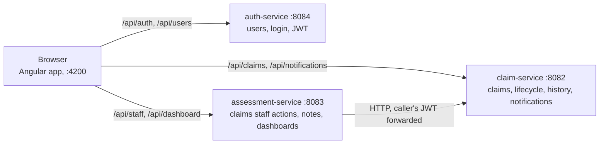

<div align="center">

# APAC Claims Platform

**Motor & property claims · Explicit workflows · Traceable decisions**

A claims management platform assessment for **Chubb APAC**: three Spring Boot microservices and an Angular app.


[Quick start](#quick-start) · [Build & test](#tests) · [API guide](docs/api-guide.md) · [Requirements](#requirements-coverage) · [Architecture](architecture.md) · [AI journal](AI_WORKING_JOURNAL.md)

</div>

---

A claims platform built as three Spring Boot microservices and an Angular single-page app. Claimants file and track
insurance claims, claims staff work a queue and decide them, and managers see liability exposure and claims staff
workload.

| Role | Code | Can do |
|---|---|---|
| **Claimant** | `CLAIMANT` | Register, sign in, file a claim, see and track their own claims, answer a claims staff member's request for information, read notifications |
| **Claims staff** | `CLAIMS_STAFF` | See the work queue, take a claim, approve, reject or ask for more information, add internal notes, read notifications |
| **Manager** | `MANAGER` | Dashboard: totals by status, liability exposure, claims staff workload, all by market and in USD |


## Contents

1. [Business context](#business-context)
2. [At a glance](#at-a-glance)
3. [Quick start](#quick-start) · [demo logins](#demo-logins) · [seed data](#seed-data) · [try it end to end](#try-it-end-to-end)
4. [A tour of the app](#a-tour-of-the-app)
5. [Requirements coverage](#requirements-coverage)
6. [API](#api) · [configuration](#configuration)
7. [Tests](#tests)
8. [Repository layout](#repository-layout) · [documentation map](#documentation-map)
9. [Known limitations](#known-limitations) · [troubleshooting](#troubleshooting)

## Business context

Chubb APAC processes motor and property claims across six markets. The scenario this platform answers:

> Today the process is fragmented: claimants submit by phone or email and wait with no visibility into what is happening.
> Claims staff manage incoming work from shared inboxes and spreadsheets, with no consolidated view of their workload.
> Managers have no real-time picture of outstanding claims or liability exposure.

| Who | The problem today | What the platform provides |
|---|---|---|
| **Claimants** | Submit by phone or email, then wait with no visibility | Self-service portal: file a claim online, follow it on a progress tracker and a timeline, get an in-app notification at every step, and answer a claims staff member's request for information in the same place ([claimant screens](#a-tour-of-the-app)) |
| **Claims staff** | Work from shared inboxes and spreadsheets, with no consolidated view of their workload | One work queue of submitted claims nobody holds (oldest first), *Take claim* in one click, a tab for the claims they hold, search by claim number, policy number, status, market, date range and claims staff member, internal notes, and an audit trail on every claim |
| **Managers** | No real-time picture of outstanding claims or liability exposure | Manager dashboard, computed live on every request: totals by status, pending, liability exposure (`SUM(claimAmount) WHERE status != SETTLED`), claims and value by status, each market side by side in its own currency and in USD, and per-claims staff workload; every dashboard can be narrowed to one market |

How far the demo goes toward the scenario, stated plainly:

* **Motor and property.** Claim types `AUTO` and `HOME` carry the seed data (146 and 104 of the 250 claims, with policy numbers
  starting `MTR-` and `PRP-`). The schema also accepts `HEALTH`, `TRAVEL`, `PERSONAL_ACCIDENT` and `OTHER`.
* **Six markets, six currencies.** Every claim carries a `market` (Australia, Hong Kong, Japan, Malaysia, New Zealand or
  Singapore) and is in that market's currency (AUD, HKD, JPY, MYR, NZD, SGD). The claimant chooses the market when filing,
  claims can be searched and sorted by it, and a claims staff member can narrow the work queue to one market. The manager dashboard can be
  read for every market or for one, with each market's exposure side by side in its own currency and in USD, so a manager can
  now answer "what is our exposure in Japan?". The USD figures use fixed, indicative exchange rates, not live ones. See
  [known limitations](#known-limitations).
* **Visibility without phone or email.** Claimants are told of progress inside the portal (in-app notifications). Email and
  SMS alerts, and taking claims by phone or email, are not built.

## At a glance



| Service | Port | Owns (own H2 database, Flyway-managed) |
|---|---|---|
| auth-service | 8084 | `users` |
| claim-service | 8082 | `claims`, `claim_history`, `notifications` |
| assessment-service | 8083 | `claim_assessments`, `claim_notes` |
| Angular dev server | 4200 | proxies `/api/*` to the three services, so the browser sees one origin and no CORS is needed |

| | |
|---|---|
| Backend | Java (built on **JDK 27**, see the note below), Spring Boot 3.5, Spring Security with JWT (jjwt), Spring Data JPA, H2, Flyway, springdoc OpenAPI, Bean Validation, JUnit 5, Mockito, MockMvc |
| Frontend | **Angular 22**, Angular Material 3, reactive forms, signals, route guards, Vitest |
| Style | Constructor injection, Java records for DTOs, no Lombok, no Docker, no Kafka (events go through an abstraction) |

> **Differences from the brief.** `CLAUDE.md` asks for Java 21, Angular 19 and auth-service on port 8081. The backend is
> built and tested on JDK 27 (`java.version` in `backend/pom.xml`; not tried on 21), the front end was scaffolded with
> Angular 22, and auth-service was moved to **8084** because it and the front end were both found using 8081 on the
> author's machine.

## Quick start

You need a JDK (the build uses 27), and Node.js with npm (developed on Node 26.3 / npm 11.16). Maven is **not**
needed; the repository carries the Maven wrapper. Ports **8082, 8083, 8084 and 4200** must be free.

Start the three services, each in its own terminal, from the `backend` folder (use `./mvnw` instead of `.\mvnw.cmd`
on macOS/Linux):

```powershell
.\mvnw.cmd -pl auth-service spring-boot:run         # http://localhost:8084
.\mvnw.cmd -pl claim-service spring-boot:run        # http://localhost:8082
.\mvnw.cmd -pl assessment-service spring-boot:run   # http://localhost:8083
```

Each takes roughly 30 to 70 seconds to start (more on a slow disk). You can equally run the three `*Application` classes
from your IDE. Then, from `frontend/claims-portal`:

```powershell
npm install
npm start          # ng serve, http://localhost:4200
```

Open **http://localhost:4200**. The dev server proxies `/api/*` to the three services (`proxy.conf.json`), so there is
nothing else to configure and no CORS to worry about.

### Demo logins

The login page has quick-fill buttons for these in development builds.

| Role | Email | Password |
|---|---|---|
| Claimant | `weiling.tan@example.com` (any seeded claimant works) | `Claimant@123` |
| Claims staff | `staff@chubb.com` (Olivia Bennett; the other claims staff use the same password) | `Staff@123` |
| Manager | `manager@chubb.com` | `Manager@123` |

New accounts created through **Register** are always claimants.

### Seed data

On start every service loads demo data through Flyway (`V2__seed_data.sql`): 26 users (1 manager, 5 claims staff, 20
claimants), 250 claims (Australia 70, Hong Kong 30, Japan 40, Malaysia 35, New Zealand 25, Singapore 50), 500 history entries, 200 notifications, 150 assessments and 200 notes. The manager dashboard
should initially read:

| Total | Pending | Approved | Rejected | Settled | Liability exposure | Waiting in queue |
|---|---|---|---|---|---|---|
| 250 | 168 | 28 | 18 | 36 | USD 2,674,303.58 | 100 |

Each claim is in its market's own currency (AUD, HKD, JPY, MYR, NZD, SGD); the dashboard converts them to USD at fixed,
indicative rates (`app.dashboard.rates`, below), which is why the figure is in USD.

Databases are **in memory**, so every restart returns to exactly this state and anything you create is lost. To start
with an empty platform instead, set `FLYWAY_TARGET=1` before starting the services.

### Try it end to end

1. Sign in as the claimant, **New claim**, fill the form, submit. The claim starts as *Submitted*.
2. Sign out, sign in as the claims staff member. The work queue lists oldest first, so click the **Submitted** column header once to
   put your new claim at the top, open it and **Take this claim**, add an internal note, then **Request information**.
3. Sign back in as the claimant. The claim shows the claims staff member's question; reply. It returns to *Under review*.
4. As the claims staff member, **Approve** (or **Reject** with a reason).
5. Sign in as the manager: the dashboard totals and liability exposure have moved by that one claim.

The claimant's notification bell fills up along the way. The same journey through the API, with real requests and
responses, is in [docs/api-guide.md](docs/api-guide.md).

## A tour of the app

Screenshots of the running app on the seed data (development build, 1440 × 900).

| | |
|---|---|
| **Sign in.** One login for all roles, with quick-fill demo accounts in development builds. |  |
| **Claimant: my claims.** Search by claim or policy number, status, market and date range; sort (including by market) and page; each amount in the claim's own currency (here SGD); status chips; unread-notification dot on the bell. |  |
| **Claimant: file a claim.** Validated reactive form (policy number format, a required market, date not in the future, amount greater than zero). The amount's currency follows the market (here Japan, so JPY); the server sets it, the form never sends one. |  |
| **Claimant: claim details.** The claim's facts, including its market, and the audit timeline (scrolled down here; above it are a progress tracker and, when claims staff need something, the question with a reply box). |  |
| **Claimant: notifications.** One entry per lifecycle event, unread highlighted, filter and mark-all-read. |  |
| **Claims staff: work queue.** Submitted claims nobody holds, oldest first, with a market column and filter and a one-click *Take claim*; a second tab lists the claims the staff member holds. |  |
| **Claims staff: work queue by market.** Choosing a market (here Japan) narrows the queue to the claims filed there: 19 of the 100 waiting in the seed data. |  |
| **Claims staff: claim review.** The decision actions (request information, reject, approve), the claim's facts and internal notes the claimant never sees. |  |
| **Manager: dashboard.** Liability exposure in USD with its formula, a Market selector, status totals, and claims and value by status; claims staff workload is further down the page. |  |
| **Manager: by market.** Every market side by side: claims, pending, and exposure in its own currency and in USD. It stays in view whichever market is selected above. |  |
| **Manager: one market.** Choosing Japan narrows the headline figures, the charts and the claims staff workload to Japanese claims. |  |

## Requirements coverage

How the brief in [CLAUDE.md](CLAUDE.md) maps to the code. "Verified" means checked in the repository or by running it.

| Requirement | Status | Where / notes |
|---|---|---|
| Three microservices (Auth, Claim, Assessment) and an Angular front end | Done | `backend/*-service`, `frontend/claims-portal` |
| Spring Security, JWT bearer tokens, roles CLAIMANT / CLAIMS_STAFF / MANAGER | Done | `security` and `config/SecurityConfig` in each service; role matrix tested |
| H2 + Flyway, never automatic schema generation | Done | `db/migration` in each service; `ddl-auto: validate` in all three |
| No Lombok, PostgreSQL, MySQL, Docker or Kafka | Verified | no Lombok in any `pom.xml` or source file; no PostgreSQL, MySQL or Kafka dependency or configuration; no Dockerfile or compose file |
| Constructor injection, Java records for DTOs | Verified | no `@Autowired` in production code (only in test classes); all 36 `dto` types are records |
| OpenAPI / Swagger | Done | Swagger UI on each service ([below](#api)) |
| Auth endpoints (register, login, `users/me`) | Done | [auth-service](#api) |
| Claim endpoints (create, get by number, my-claims, search, additional-info) | Done | plus notification endpoints the UI needs |
| Assessment endpoints (unassigned, assign, approve, reject, request-info, notes, three dashboards) | Done | plus `GET .../notes` |
| Claim lifecycle, only valid transitions | Done, with one gap | transition table in `ClaimStatus`; nothing can move a claim to `SETTLED` yet ([limitations](#known-limitations)) |
| Event publisher pattern | Done | `ClaimEventPublisher` + `LocalClaimEventPublisher` (log, audit history, notifications); the brief's events plus `ADDITIONAL_INFO_RECEIVED` |
| Dashboard: totals, pending, approved, rejected, claims staff workload, liability exposure | Done, by market and in USD | exposure is `SUM(claimAmount) WHERE status != SETTLED` converted to USD at fixed indicative rates, in one class; every dashboard takes an optional `market`, and `byMarket` shows each market in its own currency and in USD |
| Business context: six markets, each in its own currency | Done | a `market` and a `currency` on every claim; market filter on search, the work queue and the dashboards ([business context](#business-context)) |
| Search by claim number, policy number, status, date range, assigned staff member; paging and sorting | Done, plus market | `GET /api/claims/search`; the work queue also filters by market |
| Tests: service, controller, security, dashboard (JUnit 5, Mockito, MockMvc) | Done | 467 backend tests, plus 276 front-end tests ([results](#tests)) |
| Angular: Auth, Claimant, Staff, Manager, Shared, Core; the nine pages; reactive forms; route guards | Done | feature folders of standalone, lazy-loaded components rather than `NgModule`s |
| README.md, architecture.md, AI_WORKING_JOURNAL.md | Done | [documentation map](#documentation-map) |

## API

Interactive docs (Swagger UI, with a bearer-token "Authorize" button) and the in-memory databases:

| Service | Swagger UI | H2 console (JDBC URL, user `sa`, empty password) |
|---|---|---|
| auth-service :8084 | http://localhost:8084/swagger-ui.html | `jdbc:h2:mem:authdb` at `/h2-console` |
| claim-service :8082 | http://localhost:8082/swagger-ui.html | `jdbc:h2:mem:claimdb` at `/h2-console` |
| assessment-service :8083 | http://localhost:8083/swagger-ui.html | `jdbc:h2:mem:assessmentdb` at `/h2-console` |

Calls need `Authorization: Bearer <accessToken>` from `POST /api/auth/login`. Tokens last one hour. A worked example with
`curl`, real responses and every error shape is in **[docs/api-guide.md](docs/api-guide.md)**.

**auth-service**

| Endpoint | Who | Purpose |
|---|---|---|
| `POST /api/auth/register` | public | Create a claimant account |
| `POST /api/auth/login` | public | Returns `accessToken`, `tokenType`, `expiresIn`, `user` |
| `GET /api/users/me` | any signed-in user | The current user |

**claim-service**

| Endpoint | Who | Purpose |
|---|---|---|
| `POST /api/claims` | claimant | File a claim (201, `Location` header); `market` (AU, HK, JP, MY, NZ, SG) is required and sets the claim's currency |
| `GET /api/claims/my-claims` | claimant | Own claims, paged and sortable |
| `GET /api/claims/search` | any role (claimants see only their own) | Filter by `claimNumber`, `policyNumber`, `status`, `market`, `fromDate`, `toDate`, `assignedStaffId`; paged, sortable |
| `GET /api/claims/{claimNumber}` | any role (claimants: own) | The claim with its full history |
| `POST /api/claims/{id}/additional-info` | claimant (own claim, while *More info required*) | Answer the claims staff |
| `GET /api/notifications`, `GET /api/notifications/unread-count` | any role | Your own inbox and badge count |
| `POST /api/notifications/{id}/read`, `POST /api/notifications/read-all` | any role | Mark read |
| `/api/internal/claims/**` | claims staff / manager | Used by assessment-service; not meant for clients |

**assessment-service**

| Endpoint | Who | Purpose |
|---|---|---|
| `GET /api/staff/claims/unassigned` | claims staff | Work queue: submitted claims nobody holds; optional `market` |
| `POST /api/staff/claims/{id}/assign` | claims staff | Take a claim (becomes *Under review*) |
| `POST /api/staff/claims/{id}/approve` · `/reject` · `/request-info` | assigned staff member | Decide, with a comment, a reason (required) or a question (required) |
| `GET` / `POST /api/staff/claims/{id}/notes` | claims staff | Read and add internal notes |
| `GET /api/dashboard/status-summary` · `/staff-workload` · `/liability-exposure` | manager | Dashboard figures, computed live; optional `market`; money in USD, converted at fixed indicative rates |

Paging is zero-based (`page`, `size`, default 20, capped at 100) and sorting is `sort=field,asc|desc` over a fixed list of
fields. Every error has the same JSON shape (`timestamp`, `status`, `error`, `message`, `path`, optional
`fieldErrors`). Claim lifecycle: `SUBMITTED → UNDER_REVIEW ⇄ MORE_INFO_REQUIRED`, then `APPROVED` or `REJECTED`, then
`SETTLED`; only these transitions are allowed.

## Configuration

Everything has a development default; override with environment variables.

| Variable | Default | Meaning |
|---|---|---|
| `JWT_SECRET` | a development-only value | HS256 signing secret, at least 32 bytes. **Must be identical in all three services.** |
| `SERVER_PORT` | 8084 / 8082 / 8083 | Standard Spring Boot override of a service's port. If you change one, update `frontend/claims-portal/proxy.conf.json` and restart `npm start` |
| `FLYWAY_TARGET` | `latest` | `1` = schema only, no demo data |
| `DB_URL`, `DB_USERNAME`, `DB_PASSWORD` | in-memory H2, `sa`, empty | Per-service database |
| `CLAIM_SERVICE_URL` | `http://localhost:8082` | Where assessment-service finds claim-service |
| `app.dashboard.reporting-currency`, `app.dashboard.rates` (assessment) | `USD`; per 1 USD: AUD 1.50, HKD 7.80, JPY 150, MYR 4.50, NZD 1.65, SGD 1.35 | The currency the dashboards report in, and the fixed, indicative rates used to convert each market's amounts into it. Not live rates. Keep them equal to the rates the seed amounts were converted at, or the documented USD figures drift |
| `app.seed.demo-users` (auth) | `true` | Ensures the demo claims staff and manager accounts exist; turn off outside development |

## Tests

```powershell
# Backend: 467 tests (auth 79, claim 225, assessment 163)
cd backend
.\mvnw.cmd test

# Frontend: 276 tests in 23 files (Vitest + jsdom)
cd frontend\claims-portal
npx ng test --watch=false
```

Backend: service and lifecycle rules, controllers (MockMvc), security (role matrix, forged/expired tokens), dashboards and
liability maths, repositories and search, and integration tests on H2 + Flyway including the seed data. Frontend: guards,
interceptors, stores, API clients, routes, the auth and claimant pages, the work queue, the manager dashboard and the
utilities. Stop running services before
`mvnw test` if they were started from the same folder, since both write to `target/`.

### Latest results (2026-10-23, JDK 27)

| Suite | Tests | Passed | Failed | Skipped |
|---|---:|---:|---:|---:|
| auth-service | 79 | 79 | 0 | 0 |
| claim-service | 225 | 225 | 0 | 0 |
| assessment-service | 163 | 163 | 0 | 0 |
| **Backend total** | **467** | **467** | **0** | **0** |
| Frontend (23 files) | 276 | 276 | 0 | 0 |
| **All** | **743** | **743** | **0** | **0** |

Both suites were run in full on 2026-10-23, after the roles and the claims staff data names were renamed, in a copy of
`backend/` so that running services were not disturbed. All three backend services passed in a single `mvnw test` run, the
flaky test described under *Known limitations* included, and the production front-end build passes. That is not the whole
history: earlier the same day, before the renames, the first full backend run had failures. claim-service had 1, a seed
assertion that still expected one statistics row per status (fixed since), and assessment-service had **1 out of 163**,
the flaky test, which has failed under load three times now (on 2026-10-22 and twice on 2026-10-23) and passes on re-run.
That test has not been fixed.

### Coverage (measured 2026-10-22)

These figures were taken before the market field, currency and the dashboard changes were added. The new code is covered by
the new tests (included in the counts above), but the percentages were not re-measured.

Backend, measured with JaCoCo 0.8.15 (classes with no executable code, such as records and interfaces, are not counted):

| Service | Instructions | Branches | Lines | Methods |
|---|---:|---:|---:|---:|
| auth-service | 93.0% (1002 / 1077) | 61.8% (21 / 34) | 93.4% (227 / 243) | 93.9% (93 / 99) |
| claim-service | 99.1% (2608 / 2631) | 91.4% (85 / 93) | 98.8% (514 / 520) | 98.4% (186 / 189) |
| assessment-service | 97.4% (2597 / 2667) | 78.7% (74 / 94) | 97.4% (493 / 506) | 97.8% (177 / 181) |
| **Backend total** | **97.4%** (6207 / 6375) | **81.4%** (180 / 221) | **97.2%** (1234 / 1269) | **97.2%** (456 / 469) |

The uncovered backend lines are mostly the three `GlobalExceptionHandler` classes (auth and assessment each miss 10 lines),
the `main` methods of the three application classes, and a handful of single lines elsewhere.

Frontend, measured with Vitest's V8 provider (includes the shared test helpers in `src/testing`):

| Statements | Branches | Functions | Lines |
|---:|---:|---:|---:|
| 67.3% (1656 / 2460) | 73.9% (636 / 861) | 69.6% (275 / 395) | 69.7% (1102 / 1581) |

The front-end figure is held down by the claims staff and manager pages and a few shared components that have no spec of their
own. Share of lines covered: claims staff **claim-review** 1%, **my-assigned-claims** 5%, **unassigned-queue** 52%, manager
**dashboard** 35%, the **bar-chart** component 1%, the **text-prompt dialog** 7% and the **notifications page** 49%. The
core services, interceptors, login, registration, create-claim and my-claims pages are at 92-98%, and claim-details at 89%. The work queue's `unassigned-queue` and the manager dashboard have had specs since, which these figures
predate.
(Vitest's text report leaves out files that are 100% covered, so the three guards do not appear in it; they are 100%
covered and counted in the totals.)

To reproduce the coverage figures. Neither tool is wired into the build: the JaCoCo goals are run from the command line, and
the Vitest coverage package is not in `package.json`.

```powershell
# Backend: HTML reports at <service>\target\site\jacoco\index.html
cd backend
.\mvnw.cmd org.jacoco:jacoco-maven-plugin:0.8.15:prepare-agent test org.jacoco:jacoco-maven-plugin:0.8.15:report

# Frontend: install the provider once (matches vitest 5.0.5), then run with --coverage
cd frontend\claims-portal
npm install --no-save @vitest/coverage-v8@5.0.5
npx ng test --watch=false --coverage
```

Production build: `npx ng build` from `frontend/claims-portal` (output in `dist/`).

## Repository layout

```
backend/
  pom.xml                     parent POM (modules: auth, claim, assessment)
  auth-service/               users, registration, login, JWT
  claim-service/              claims, lifecycle, history, notifications, search, event publisher
  assessment-service/         claims staff actions, notes, dashboards; calls claim-service
    src/main/resources/db/migration/   V1 schema + V2 seed (one pair per service)
frontend/claims-portal/       the Angular app (its own README covers the front end in detail)
  src/app/core/               guards, interceptors, shell layout, API clients, auth store
  src/app/shared/             reusable components, models, utilities
  src/app/features/           auth, claimant, staff, manager pages (lazy-loaded)
  proxy.conf.json             /api/* → the three services
docs/
  api-guide.md                worked API examples and error shapes
  screenshots/                the images used above
CLAUDE.md                     the project brief
README.md · architecture.md · AI_WORKING_JOURNAL.md
```

### Documentation map

| Document | Read it for |
|---|---|
| [README.md](README.md) (this file) | Running the platform, demo logins, what is covered, test results, limitations |
| [architecture.md](architecture.md) | Design: service boundaries, request flow, lifecycle, security, event pattern, data model, dashboards, front end, decisions and trade-offs, assumptions, known gaps |
| [docs/api-guide.md](docs/api-guide.md) | Calling the API: a full claim journey with `curl`, real responses, every error shape |
| [frontend/claims-portal/README.md](frontend/claims-portal/README.md) | The Angular app: scripts, routes, source layout, how it works |
| [AI_WORKING_JOURNAL.md](AI_WORKING_JOURNAL.md) | How AI assistance was used: prompts, what was accepted and rejected, manual changes, verification |
| [CLAUDE.md](CLAUDE.md) | The original brief |

## Known limitations

* **Nothing settles a claim.** There is no settle endpoint, so *Settled* only exists in the seed data and liability
  exposure can never decrease.
* Per the brief's formula, **rejected claims count toward liability exposure**; only settled ones are excluded.
* Claims staff can only take claims for themselves, and an assignee is shown as "Staff #n" because there is no staff
  directory.
* **One flaky backend test.** `StaffWorkflowIntegrationTest.aStaffMemberTakesAClaimAsksForInformationAndApprovesIt`
  (assessment-service) mints one JWT at the start and later compares it with the token its request helper mints again. A JWT
  carries its issue time to the second, so the two differ whenever the clock ticks over in between. It failed once in the
  2026-10-22 run (under the coverage agent) and passed on re-run. The fix is to capture the token the request actually used.
* Not production-ready by design: in-memory databases, an open H2 console and Swagger UI, a shared HS256 secret, no
  refresh tokens or rate limiting.
* **Exchange rates are fixed, not live.** The dashboards convert every market's amounts to USD at indicative rates held in
  configuration, so the USD figures are for orientation (the per-market figures in local currency are exact) and move if the
  rates are changed.
* A claim is always in the currency of its market: there is no way to file, say, a USD-denominated claim in Singapore. Yen are
  stored with two decimals although the currency has none.
* The market is chosen by the claimant and is not checked against the policy number.
* **Renames edited the migrations in place.** The role codes (`CLAIMS_STAFF`, `MANAGER`) and the claims-staff data names
  (`assignedStaffId`, `staffId`, `staffName`, the `staff_id` columns, `/api/dashboard/staff-workload`) were changed by editing
  the Flyway `V1` and `V2` files, which works only because the databases are in memory and rebuilt on every start. Against a
  database that already holds data it would take new migrations that rename the columns and rewrite the stored role values.
* The claim-review and my-assigned-claims pages have no component specs (they were checked by walking the running app); the
  work queue and the manager dashboard have one each.

More in [architecture.md](architecture.md#15-known-gaps-and-next-steps).

## Troubleshooting

| Symptom | Fix |
|---|---|
| Dashboard or work queue shows "service unavailable" (503) | claim-service (8082) is not running; assessment-service depends on it |
| "Port 808x was already in use", or `ng serve` offers a different port | Something already holds the port, usually the same service started twice (an IDE run configuration and a terminal). Find it with `netstat -ano \| findstr :8084` then `tasklist /FI "PID eq <pid>"` (macOS/Linux: `lsof -i :8084`), and stop it |
| Sign-in fails or calls go to the wrong service after a port change | The dev-server proxy reads `proxy.conf.json` only when it starts: stop `npm start` and run it again |
| Everything signs out after changing `JWT_SECRET` in one service | The secret must match in all three; restart them together |
| Startup error "required a bean of type PasswordEncoder", or `application.yml` / `db/migration` missing from `target/classes`, or "Failed to delete …\target\classes" | The repository is inside a OneDrive folder, which turns freshly built `target` folders into placeholders and breaks Maven and IDE builds. Delete the affected `target` folder (`Remove-Item -Recurse -Force <service>\target`) and rebuild. The lasting fix is to keep the repo outside OneDrive. |
| First page load after `npm start` is slow | The dev server compiles on demand; later loads are fast |
