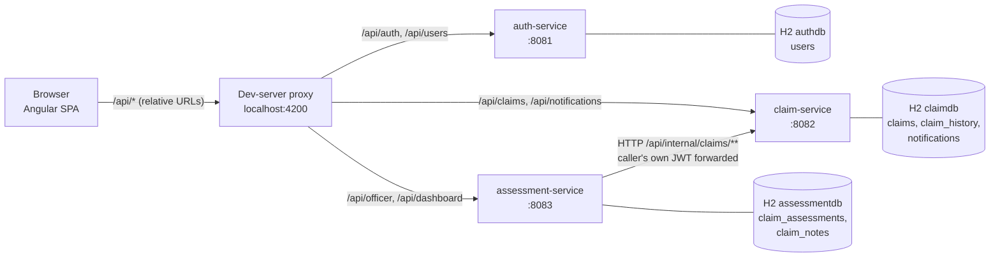
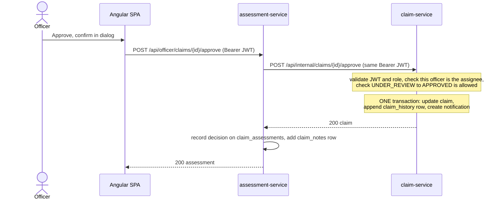
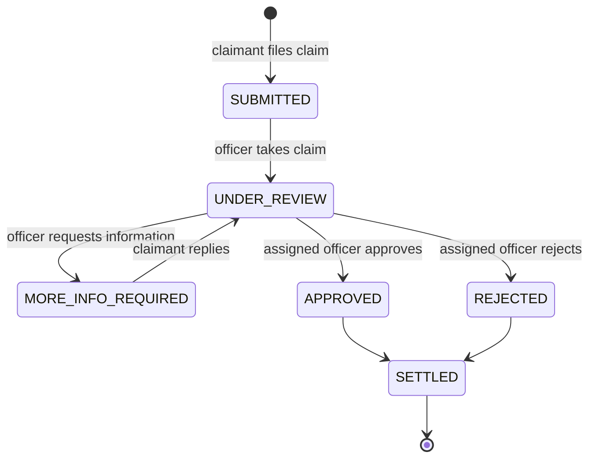

# Architecture

How the Chubb APAC Claims Management Platform is put together, and why. For how to run it, see [README.md](README.md).

## 1. Goals and constraints

The platform lets claimants file and track insurance claims, lets claims officers review and decide them, and gives
administrators a view of the book of business. The brief ([CLAUDE.md](CLAUDE.md)) fixes several constraints that shape
everything below:

| Constraint | Consequence |
|---|---|
| Microservices: Auth, Claim, Assessment, plus an Angular front end | Three Spring Boot services, each with its own port and its own database |
| H2 + Flyway only; no Postgres/MySQL, no Docker, no Kafka infrastructure | In-memory H2 per service; Flyway owns every schema; events go through an abstraction so a broker can be added later |
| No Lombok; constructor injection; Java records for DTOs | Plain Java throughout; every dependency is a `final` constructor parameter |
| Only valid status transitions | The lifecycle is an enum with an explicit transition table (section 5) |
| Liability exposure = `SUM(claimAmount) WHERE status != SETTLED` | One calculator class owns the rule (section 9) |

Two deliberate departures from the brief are recorded in section 14: the build uses JDK 27 (not 21) and Angular 22 (not 19).

## 2. System overview



The browser only ever talks to one origin. In development the Angular dev server's proxy
(`frontend/claims-portal/proxy.conf.json`) routes each `/api/...` prefix to the right service, so the app contains no
host names and **no CORS configuration is needed**. A production deployment would put a reverse proxy in the same role.

Services never read each other's databases. The only service-to-service call is assessment-service to claim-service.

## 3. Services and the data they own

| Service | Port | Owns | Responsibility |
|---|---|---|---|
| **auth-service** | 8081 | `users` | Registration, login, JWT issue, `GET /api/users/me` |
| **claim-service** | 8082 | `claims`, `claim_history`, `notifications` | Claim creation, tracking, search, the whole lifecycle and audit trail, notifications |
| **assessment-service** | 8083 | `claim_assessments`, `claim_notes` | The officer's side: work queue, assign, approve, reject, request info, notes, and the admin dashboards |

**Claim-service is the single source of truth for claims and for every status change.** Assessment-service holds no
claim data of its own; it holds what belongs to the officer's act of assessing (who took the claim, the decision, the
review notes). Ids that cross a service boundary (`claimant_id`, `assigned_officer_id`, `claim_id`, `officer_id`) are
*logical* references: there are no cross-database foreign keys, because there are no cross-database transactions.

Each service is layered the same way: `controller` (HTTP only, no business logic) → `service` (rules and
transactions) → `repository` (Spring Data JPA) → `entity`, with `dto` records at the edge, `security` for JWT handling,
and `exception` for the error mapping.

## 4. Key request flow: an officer approves a claim



Three design choices are visible here.

1. **The caller's token is forwarded, not replaced.** Assessment-service attaches the officer's own bearer token
   (`BearerTokenForwardingInterceptor`) to its call, so claim-service authorizes the action itself: "only the assigned
   officer may decide" is enforced where the data lives. No service credentials exist, and assessment-service cannot
   do anything the officer could not.
2. **Claim-service first, local write last.** If claim-service refuses (wrong state, not the assignee, claim gone), nothing
   is stored in assessment-service. If the local write fails after claim-service accepted, the claim is still correct
   and the missing assessment row is recreated by the officer's next action on that claim. The alternative (local first)
   could leave an assessment saying "approved" for a claim that was not.
3. **Failures are translated, not leaked.** `RestClaimServiceClient` maps claim-service's 400/403/404/409 onto the same
   statuses with claim-service's own message (an officer sees "This claim is not assigned to you"), maps 5xx, timeouts
   and refused connections to **503**, and an unreadable reply to 502. Timeouts are 2 s to connect and 5 s to read.

## 5. Claim lifecycle



The transition table lives in one place, `ClaimStatus.allowedTransitions()` in claim-service, and `Claim.transitionTo`
refuses anything else with `InvalidStatusTransitionException` (HTTP 409). Who may trigger each move:

| Transition | Triggered by | Endpoint | Extra rule |
|---|---|---|---|
| (new) → SUBMITTED | CLAIMANT | `POST /api/claims` | Incident date not more than one day ahead (time-zone slack) |
| SUBMITTED → UNDER_REVIEW | OFFICER | `POST /api/officer/claims/{id}/assign` | Self-assign only; the officer becomes the assignee |
| UNDER_REVIEW → MORE_INFO_REQUIRED | assigned OFFICER | `…/request-info` | Message required |
| MORE_INFO_REQUIRED → UNDER_REVIEW | the claim's CLAIMANT | `POST /api/claims/{id}/additional-info` | Only on their own claim |
| UNDER_REVIEW → APPROVED | assigned OFFICER | `…/approve` | Comment optional |
| UNDER_REVIEW → REJECTED | assigned OFFICER | `…/reject` | Reason required |
| APPROVED/REJECTED → SETTLED | nobody yet | none | **No settle endpoint exists** (section 15) |

Concurrency: `claims` carries a `@Version` column (optimistic locking). Two officers racing for the same claim cannot
both win; the loser gets a 409 and the UI reloads the claim and says it was already taken.

## 6. Security

**Authentication.** auth-service issues an HS256 JWT valid for one hour (`app.jwt.expiration-ms`). Claims: `sub` = user id,
plus `email`, `name`, `role`. Passwords are BCrypt-hashed; emails are stored trimmed and lower-case (a database `CHECK`
insists). All three services validate tokens with the same shared secret (`JWT_SECRET`); each refuses to start if the
secret is shorter than 32 bytes. Services are stateless: no sessions, CSRF disabled (bearer tokens, no cookies).

**Authorization** is declared per service in its `SecurityConfig` as URL rules, and the service layer then narrows
what a permitted role can see:

| Service | Rule |
|---|---|
| auth | `POST /api/auth/register`, `POST /api/auth/login` public; everything else needs a valid token |
| claim | `POST /api/claims`, `GET /api/claims/my-claims`, `POST /api/claims/*/additional-info`: CLAIMANT. `GET /api/claims/search` and `GET /api/claims/{claimNumber}`: any role. `/api/notifications/**`: any role. `/api/internal/**`: OFFICER acts (POST), OFFICER or ADMIN reads (GET) |
| assessment | `/api/officer/**`: OFFICER. `/api/dashboard/**`: ADMIN |

Row-level rules inside claim-service: a claimant opening someone else's claim gets **404, not 403** (existence is not
leaked); claimants' searches are silently restricted to their own claims; notifications only ever show and change the
caller's own, and another user's notification id is a 404.

Registration can only create CLAIMANTs. Officer and admin accounts come from the seed migration and, in development,
from `DemoUserSeeder` (`app.seed.demo-users=true`).

Security errors (401/403) are rendered by `JsonSecurityErrorHandler` in the same JSON shape as every other error.

**Front end.** The token is kept in `sessionStorage` (tab-scoped), is attached only to same-origin `/api/` calls and never
to login/register, and a 401 on a protected call signs the user out. Route guards and the role-filtered navigation are
usability, not security: every call is re-authorized by the backend.

Not done, deliberately for a take-home: refresh tokens, asymmetric signing (so only auth-service holds a signing key),
login rate limiting, account lockout. The H2 console and Swagger UI are open (`permitAll`) and must be switched off outside
development.

## 7. Event publisher pattern

`ClaimEventPublisher` is the abstraction between the service layer and "what happens when something happens to a claim":

```java
public interface ClaimEventPublisher { void publish(ClaimEvent event); }
```

`ClaimService` builds a `ClaimEvent` and calls `publish`; it knows nothing else. Today the only implementation is
`LocalClaimEventPublisher`, which does three things inside the caller's transaction:

1. logs the event,
2. appends a row to `claim_history` (the audit trail the claimant sees as the timeline),
3. creates the notifications decided by `ClaimNotificationFactory`.

Because it joins the caller's transaction, the claim change, its audit row and its notifications commit or roll back
together. Event types: `CLAIM_CREATED`, `CLAIM_ASSIGNED`, `CLAIM_APPROVED`, `CLAIM_REJECTED`,
`ADDITIONAL_INFO_REQUESTED`, plus `ADDITIONAL_INFO_RECEIVED` (added so the claimant's reply is audited and the officer
can be told).

Who is notified: the **claimant** gets one notification per lifecycle event; the **assigned officer** gets one only when
the claimant replies; **admins are never notified**.

A `KafkaEventPublisher` would be a second `ClaimEventPublisher` bean and no service-layer change. The one thing to design
at that point is the transaction boundary: the local publisher is atomic with the claim update, a broker publisher
would need an outbox or similar to keep the same guarantee.

## 8. Data architecture

* **Flyway owns all DDL**; Hibernate runs with `ddl-auto: validate` and never generates schema. Each service has
  `db/migration/V1__schema.sql` and `V2__seed_data.sql`.
* Schemas use `CHECK` constraints that mirror the Java enums (status, role, claim type, event type, note type), a
  `claim_amount > 0` check, and `updated_at >= created_at`.
* `claim_number_seq` (a database sequence) feeds claim numbers of the form `CLM-<year>-<6-digit sequence>`; the sequence
  is global, so numbers never repeat across years.
* Indexes follow the queries: claims by claimant, status, `(assigned_officer_id, status)`, policy number, created date;
  history by `(claim_id, created_at)`; notifications by `(recipient_id, is_read, created_at)`.
* `claim_history` is insert-only (the audit trail). `claim_assessments` is unique per claim and also uses a version column.
* Claimant name/email on a claim and officer name on an assessment are **snapshots taken from the token**, because
  neither service has a users table. This is why the UI shows "Officer #2" for an assignee rather than a name; there is no
  officer directory to look one up in.
* **Seed data** (V2) is one coherent generated world: 26 users, 250 claims, 500 history rows, 200 notifications, 150
  assessments, 200 notes. Starting a service with `FLYWAY_TARGET=1` skips V2 and gives an empty platform. The expected
  dashboard figures are printed in the header of claim-service's V2 and pinned by `SeedDataIntegrationTest` in each service.
* Databases are in-memory and rebuilt on every start.

## 9. Dashboards

All three dashboards are ADMIN-only and are computed **live** from claim-service's aggregates on every request (never
cached), so they cannot disagree with the claims. Claim-service exposes raw totals (`GET /api/internal/claims/statistics`:
count and amount per status, and per officer and status via `GROUP BY`); assessment-service turns them into metrics.

| Metric | Definition |
|---|---|
| Total claims | All claims |
| Pending | SUBMITTED + UNDER_REVIEW + MORE_INFO_REQUIRED |
| Approved / Rejected / Settled | Count by status |
| Officer workload | Per officer: open (UNDER_REVIEW + MORE_INFO_REQUIRED), under review, awaiting info, approved, rejected, settled, total, and open exposure; plus the number of unassigned claims waiting |
| Liability exposure | `SUM(claimAmount) WHERE status != SETTLED`, implemented once in `LiabilityExposureCalculator` as a pure function of the per-status totals, returned with the formula text, the number of claims counted and the settled amount left out |

Consequence worth knowing: the formula follows the brief literally, so **REJECTED claims count toward exposure** (only
SETTLED are excluded). If the business meaning is "money we might still pay", rejected claims arguably should be excluded
too; that is a one-line change in assessment-service's `ClaimStatus.countsTowardLiability()` (plus the expected figures
pinned in its tests).

If claim-service is down the dashboards return 503 rather than stale figures.

## 10. Search, sorting and pagination

`GET /api/claims/search` accepts any combination (combined with AND) of: `claimNumber` (partial, case-insensitive),
`policyNumber` (partial, case-insensitive), `status` (exact), `fromDate` / `toDate` (submission date, UTC, inclusive,
`yyyy-MM-dd`), `assignedOfficerId`. Claimants are restricted to their own claims. Paging is zero-based, **20 per page by
default, 100 maximum**. Sorting is `sort=<field>,<asc|desc>` over a whitelist (`createdAt` default newest first, `updatedAt`,
`claimNumber`, `policyNumber`, `status`, `claimAmount`, `incidentDate`); any other field is a 400, never passed to the
database layer (`PageableSanitizer`). Filters are built with JPA Specifications (`ClaimSpecifications`).

The officer work queue is this same search with `status=SUBMITTED`, oldest first.

## 11. Error contract

Every failure from every service has one JSON shape:

```json
{ "timestamp": "…", "status": 400, "error": "Bad Request", "message": "Validation failed", "path": "/api/claims",
  "fieldErrors": { "claimAmount": "must be greater than zero" } }
```

`fieldErrors` is present only for validation failures. Mapping: validation / malformed body / bad sort field 400,
unauthenticated 401, wrong role or "not the assigned officer" 403, unknown (or someone else's) claim 404, invalid
transition or lost optimistic-lock race 409, claim-service unavailable 503, anything unexpected 500 with a generic
message (the cause is logged, never returned). Binding errors are rewritten so they never name Java classes.

## 12. Front end

Angular 22 standalone components, Angular Material 3 (azure/blue theme, Roboto, self-hosted icon font), reactive forms,
signals for state, no NgModules and no state library.

```
src/app/
  core/       singletons: guards, interceptors, layout shell, API clients, AuthStore, NotificationStore, models
  shared/     reusable components (claims table, filters, status chip, timeline, progress, bar chart,
              notifications page, text-prompt dialog), models, pure utilities (claim rules, dates, errors, loader)
  features/   auth, claimant, officer, admin: each a lazy route table plus its pages
```

Path aliases (`@core`, `@shared`, `@features`, `@env`, `@testing`) keep imports flat, and features never import each
other: the one page two roles need (notifications) lives in `shared`.

**Routing.** Every page is lazy-loaded, so a claimant never downloads officer or admin code.

| Area | Guard | Home |
|---|---|---|
| `/auth/*` (login, register) | `guestGuard`: signed-in users are redirected to their home | |
| `/claimant/*` | `authGuard` on the shell + `roleGuard('CLAIMANT')` (`canMatch`) | `/claimant/my-claims` |
| `/officer/*` | `authGuard` + `roleGuard('OFFICER')` | `/officer/work-queue` |
| `/admin/*` | `authGuard` + `roleGuard('ADMIN')` | `/admin/dashboard` |
| `/forbidden`, `**` | signed-in but wrong area, and not found | |

`roleGuard` is a `canMatch` so the wrong role does not even download the area. `?returnUrl=` is honoured only for
in-app paths inside the user's own area (no other origins, `//host`, backslashes or control characters).

**Session.** `AuthStore` holds the session as a signal. At start-up `provideAppInitializer` calls `restore()`, which
resumes a stored token only if it is unexpired *and* auth-service still knows the user (`/api/users/me`, 5 s timeout), so a
refresh on a protected page does not bounce through login. The session ends 30 s before the token's real expiry.

**HTTP.** All URLs are in `core/services/endpoints.ts`. Two functional interceptors, in order: `authInterceptor` adds the
bearer token (same-origin `/api/` only, never to login/register), then `errorInterceptor` converts every failure into an
`ApiError` (so no component sees `HttpErrorResponse`), signs out on a 401 from a protected call, and toasts on 403.

**Data loading.** Pages use one small helper, `loader(requestSignal, fetchFn)`: it refetches when the request signal
changes, cancels a superseded fetch (`switchMap`, so a slow reply can never overwrite a newer one), keeps the last value
while the next loads (tables do not blank on page turns), and exposes `value`, `loading` and `error` signals.

**Role-aware UI.** `reviewAccess()` (shared utility) maps claim status + assignee to what an officer may do
(take / decide / held by other / awaiting claimant / closed), so the page only offers actions the backend would accept; the
backend still checks each one. The notification bell polls `unread-count` every 60 s, renders nothing for admins, and
resets on sign-out so the next user never sees the previous user's number.

**Dashboards** use a small in-house `bar-chart` component (no charting dependency) with a "View as table" toggle for
accessibility. The status colours add success/warning roles Material 3 lacks, each paired with a container that passes
WCAG AA contrast.

## 13. Testing

| Layer | Tooling | What it covers |
|---|---|---|
| Backend unit | JUnit 5, Mockito | Service rules, lifecycle table, event publisher, notification factory, claim-number generator, JWT service, dashboard maths |
| Backend web | MockMvc | Controllers: validation, status codes, error shape |
| Backend security | MockMvc + real filter chain | Role matrix per endpoint, 401 vs 403, tampered/expired tokens |
| Backend integration | `@SpringBootTest` on H2 + Flyway | Full lifecycle, search, repositories, seed-data invariants (private H2 URL so contexts don't share data); assessment-service runs against a stub claim-service |
| Front end | Vitest + jsdom (`ng test`) | Guards, interceptors, stores, API clients, route table, auth and claimant pages, pure utilities |

Ordinary backend tests pin `spring.flyway.target=1` so they start from an empty schema; seed tests opt back in. The counts
are in the README.

Known gap: the officer and admin pages have no component specs. They were verified by walking the real UI in a browser
(claimant files, officer takes/notes/requests info, claimant replies, officer approves, admin dashboard), which found
three forms whose submit never fired (section 14), but that walkthrough script is not part of the repository.

## 14. Decisions and trade-offs

| Decision | Why | Cost |
|---|---|---|
| Claim-service owns all lifecycle changes; assessment-service calls it | One place enforces the state machine and writes the audit trail | Assessment-service depends on claim-service being up (503 otherwise) |
| Forward the caller's JWT instead of a service credential | Authorization stays where the data is; nothing extra to manage | Internal endpoints are reachable by any officer token (they are the same rules, so no extra power) |
| Claim-service call first, local write last | Never record a decision the claim did not accept | A lost local write is repaired lazily, not immediately |
| Logical cross-service ids, no shared DB | Real service independence | No referential integrity across services; snapshots of names |
| Officers can only self-assign | There is no officer directory to validate another id against | A manager cannot assign work to someone else |
| Relative `/api` URLs + dev proxy | No CORS, no host names in the app | Production needs a reverse proxy doing the same routing |
| Dashboards computed live | Always consistent with claims | Each refresh costs aggregate queries; fine at this scale |
| `LocalClaimEventPublisher` (CLAUDE.md says `LocalEventPublisher`) | Name chosen by the project owner | None |
| Extra event `ADDITIONAL_INFO_RECEIVED`, extra notification endpoints, `GET …/notes` | The UI needs them and the brief did not list them | CLAUDE.md's endpoint list is now incomplete |
| **JDK 27**, not 21 | Chosen by the project owner; it is the only JDK installed | Differs from the brief; not verified on 21 |
| **Angular 22**, not 19 | That is what the project was scaffolded with | Differs from the brief |
| `(submit)` + `preventDefault` on forms without a `FormGroup` | `(ngSubmit)` only fires from `NgForm`/`FormGroupDirective`; three forms had neither and silently did a native submit | Forms with a `FormGroup` still use `(ngSubmit)` |

## 15. Known gaps and next steps

* **Nothing moves a claim to SETTLED**, so liability exposure can never fall and the SETTLED count is only seed data. A
  settle endpoint (APPROVED or REJECTED → SETTLED) plus a `CLAIM_SETTLED` event is the natural next feature.
* No officer directory: assignee shows as "Officer #n"; managers cannot assign to others.
* `KafkaEventPublisher` and an outbox for atomic publishing.
* Production hardening: refresh tokens, asymmetric JWT, rate limiting, disabling the H2 console and Swagger UI, a real
  database (the Flyway scripts and the claim-number query, `NEXT VALUE FOR claim_number_seq`, were written for and only
  run on H2, so a move would need them reviewed), a reverse proxy.
* Component specs for the officer and admin pages, and a committed end-to-end suite.
* Initial bundle is 505.6 kB, 5.6 kB over the 500 kB *warning* budget (the error budget is 1 MB; it transfers 129 kB).
