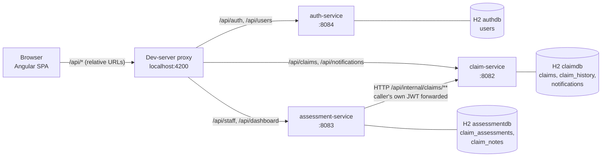
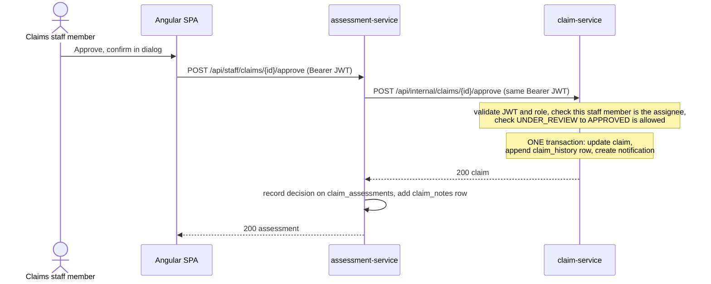
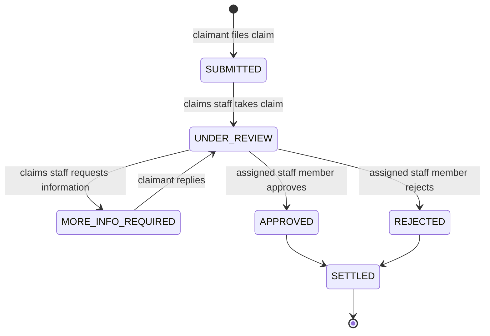
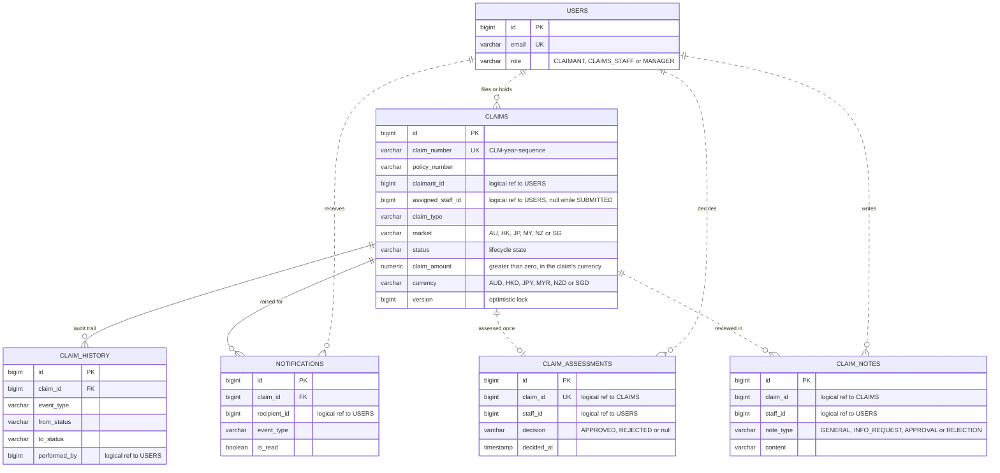

# Architecture

How the Chubb APAC Claims Management Platform is put together, and why. For how to run it, see [README.md](README.md).

## 1. Goals and constraints

### Business context

Chubb APAC processes motor and property claims across six markets. The scenario:

> Today the process is fragmented: claimants submit by phone or email and wait with no visibility into what is happening.
> Claims staff manage incoming work from shared inboxes and spreadsheets, with no consolidated view of their workload.
> Managers have no real-time picture of outstanding claims or liability exposure.

Each of the three groups gets one capability, and each capability drives a design choice:

| Who | Capability | Design consequence |
|---|---|---|
| Claimants: no visibility | File online, track status, be notified, reply to questions | Every lifecycle change writes an audit row and a notification in one transaction (section 7), so what the claimant sees cannot disagree with the claim; a claimant can only ever see their own claims (section 6) |
| Claims staff: no consolidated workload view | A single work queue, take-a-claim, notes, search | Claim-service is the single source of truth for status and ownership (section 3); an optimistic lock stops two claims staff taking the same claim (section 5); search is one filterable, paged query (section 10) |
| Managers: no real-time picture | Live dashboards and liability exposure, for every market or one at a time, in USD and in each market's own currency | Dashboards are computed from claim-service aggregates on every request and never cached (section 9), so they cannot be out of date or disagree with the claims |

What the demo covers of the scenario: motor (`AUTO`) and property (`HOME`) claims across all six markets (AU, HK, JP, MY,
NZ, SG). Every claim carries its market and is in that market's currency (AUD, HKD, JPY, MYR, NZD, SGD), so claims can be
filed in, searched by and sorted by market, a claims staff member can narrow the work queue to one market, and the dashboards can be
read for every market or for one, with the money in USD and in each market's own currency. What it does not do yet: the USD
figures use fixed indicative exchange rates rather than live ones (see the assumptions below and section 15).

### Constraints from the brief

The platform lets claimants file and track insurance claims, lets claims staff review and decide them, and gives
managers a view of the book of business. The brief ([CLAUDE.md](CLAUDE.md)) fixes several constraints that shape
everything below:

| Constraint | Consequence |
|---|---|
| Microservices: Auth, Claim, Assessment, plus an Angular front end | Three Spring Boot services, each with its own port and its own database |
| H2 + Flyway only; no Postgres/MySQL, no Docker, no Kafka infrastructure | In-memory H2 per service; Flyway owns every schema; events go through an abstraction so a broker can be added later |
| No Lombok; constructor injection; Java records for DTOs | Plain Java throughout; every dependency is a `final` constructor parameter |
| Only valid status transitions | The lifecycle is an enum with an explicit transition table (section 5) |
| Liability exposure = `SUM(claimAmount) WHERE status != SETTLED` | One calculator class owns the rule (section 9) |

Three deliberate departures from the brief are recorded in section 14: the build uses JDK 27 (not 21) and Angular 22 (not
19), and auth-service listens on port 8084 (not 8081).

### Assumptions

The brief leaves these open; the choices made are stated here so they can be challenged.

| Topic | Assumption |
|---|---|
| Who gets which role | One role per user. Registration only ever creates CLAIMANTs; claims staff and manager accounts are provisioned (seed data, and a development-only seeder) |
| "Assign claims" | A claims staff member takes a claim from the queue (self-assign). There is no staff directory, so a manager cannot assign work to someone else |
| "Pending" claims | SUBMITTED + UNDER_REVIEW + MORE_INFO_REQUIRED: everything not yet decided or settled |
| Liability exposure | The brief's formula taken literally, so REJECTED claims count (section 9) |
| Lines of business | Motor (`AUTO`) and property (`HOME`) are what the seed data and the demo show. The schema also accepts `HEALTH`, `TRAVEL`, `PERSONAL_ACCIDENT` and `OTHER` |
| Markets | The six markets are a fixed list of ISO country codes (`AU`, `HK`, `JP`, `MY`, `NZ`, `SG`), a required field on every claim. The claimant chooses it when filing; it is **not derived from, or checked against, the policy number**, because a policy number is free text (`POL-2026-12345` has no country in it). In the seed data the two always agree |
| Currency | Each market has one currency (AU AUD, HK HKD, JP JPY, MY MYR, NZ NZD, SG SGD). A claim is in the currency of the market it is filed in: the server sets it, the claimant never sends it, and the amount is entered and shown in that currency. A claim cannot be in a different currency (a USD policy filed in Singapore, say) |
| Exchange rates | The dashboards report in USD, converting at fixed, indicative rates held in assessment-service's configuration (`app.dashboard.rates`). They are not live market rates; a real deployment would take dated rates from a rates service |
| Claim types | `AUTO`, `HOME`, `HEALTH`, `TRAVEL`, `PERSONAL_ACCIDENT`, `OTHER` |
| Notifications | In-app only (no email or SMS). Claimants hear about every lifecycle event; a claims staff member only when the claimant replies; managers never |
| Settling | `SETTLED` is part of the lifecycle but the brief names no actor or endpoint for it, so none was built (section 15) |
| Data and deployment | Demo scale: in-memory databases, seeded on start, a development proxy in place of a gateway |

### Quality attributes and how they are met

| Attribute | How |
|---|---|
| **Security** | Stateless JWT with BCrypt passwords; every service validates the token and authorizes by role; row-level rules on top (section 6); a uniform error body that leaks no internals |
| **Auditability** | `claim_history` is append-only and written in the same transaction as the change; notifications and claims staff notes are insert-only |
| **Consistency** | One writer per fact: claim-service owns every status change, behind a transition table and an optimistic-lock version column |
| **Resilience** | Assessment-service bounds its calls to claim-service (2 s connect, 5 s read) and turns failures into 502/503 instead of hanging or showing stale numbers |
| **Maintainability** | Same layering in every service (controller, service, repository, entity, dto); business rules in one named class each (`ClaimStatus`, `LiabilityExposureCalculator`, `PageableSanitizer`); constructor injection throughout and no field injection in production code |
| **Testability** | 467 backend and 276 front-end tests; the event publisher (`ClaimEventPublisher`) and the claim-service client (`ClaimServiceClient`) are interfaces, and the liability calculation is a pure function |
| **Performance** | Indexes follow the queries, list endpoints are paged and capped at 100 rows, sort fields are a whitelist, dashboards use `GROUP BY` aggregates rather than loading claims |
| **Accessibility** | Material components, AA-contrast status colours, a "View as table" toggle on the dashboard charts |
| **Extensibility** | A broker can replace the local event publisher without touching the service layer (section 7); each service can move to its own database or host, because the only things they share are the JWT secret and assessment-service's configured URL for claim-service |

## 2. System overview



The browser only ever talks to one origin. In development the Angular dev server's proxy
(`frontend/claims-portal/proxy.conf.json`) routes each `/api/...` prefix to the right service, so the app contains no
host names and **no CORS configuration is needed**. A production deployment would put a reverse proxy in the same role.

Services never read each other's databases. The only service-to-service call is assessment-service to claim-service.

| Process | Port | Started with |
|---|---|---|
| Angular dev server (with the `/api` proxy) | 4200 | `npm start` in `frontend/claims-portal` |
| auth-service | 8084 | `mvnw -pl auth-service spring-boot:run` (or its `*Application` class from an IDE) |
| claim-service | 8082 | `mvnw -pl claim-service spring-boot:run` |
| assessment-service | 8083 | `mvnw -pl assessment-service spring-boot:run` |

Four processes, one JVM per service, no other infrastructure. Each service's port is `server.port` in its `application.yml`
and can be overridden with the standard `SERVER_PORT` environment variable; if you change one, update `proxy.conf.json`
(and, if it is claim-service's, `CLAIM_SERVICE_URL` for assessment-service).

## 3. Services and the data they own

| Service | Port | Owns | Responsibility |
|---|---|---|---|
| **auth-service** | 8084 | `users` | Registration, login, JWT issue, `GET /api/users/me` |
| **claim-service** | 8082 | `claims`, `claim_history`, `notifications` | Claim creation, tracking, search, the whole lifecycle and audit trail, notifications |
| **assessment-service** | 8083 | `claim_assessments`, `claim_notes` | The claims staff member's side: work queue, assign, approve, reject, request info, notes, and the manager dashboards |

**Claim-service is the single source of truth for claims and for every status change.** Assessment-service holds no
claim data of its own; it holds what belongs to the claims staff member's act of assessing (who took the claim, the decision, the
review notes). Ids that cross a service boundary (`claimant_id`, `assigned_staff_id`, `claim_id`, `staff_id`) are
*logical* references: there are no cross-database foreign keys, because there are no cross-database transactions.

Each service is layered the same way: `controller` (HTTP only, no business logic) → `service` (rules and
transactions) → `repository` (Spring Data JPA) → `entity`, with `dto` records at the edge, `security` for JWT handling,
and `exception` for the error mapping.

## 4. Key request flow: a claims staff member approves a claim



Three design choices are visible here.

1. **The caller's token is forwarded, not replaced.** Assessment-service attaches the claims staff member's own bearer token
   (`BearerTokenForwardingInterceptor`) to its call, so claim-service authorizes the action itself: "only the assigned
   claims staff member may decide" is enforced where the data lives. No service credentials exist, and assessment-service cannot
   do anything the claims staff member could not.
2. **Claim-service first, local write last.** If claim-service refuses (wrong state, not the assignee, claim gone), nothing
   is stored in assessment-service. If the local write fails after claim-service accepted, the claim is still correct
   and the missing assessment row is recreated by the claims staff member's next action on that claim. The alternative (local first)
   could leave an assessment saying "approved" for a claim that was not.
3. **Failures are translated, not leaked.** `RestClaimServiceClient` maps claim-service's 400/403/404/409 onto the same
   statuses with claim-service's own message (a claims staff member sees "This claim is not assigned to you"), maps 5xx, timeouts
   and refused connections to **503**, and an unreadable reply to 502. Timeouts are 2 s to connect and 5 s to read.

## 5. Claim lifecycle



The transition table lives in one place, `ClaimStatus.allowedTransitions()` in claim-service, and `Claim.transitionTo`
refuses anything else with `InvalidStatusTransitionException` (HTTP 409). Who may trigger each move:

| Transition | Triggered by | Endpoint | Extra rule |
|---|---|---|---|
| (new) → SUBMITTED | CLAIMANT | `POST /api/claims` | Incident date not more than one day ahead (time-zone slack) |
| SUBMITTED → UNDER_REVIEW | CLAIMS_STAFF | `POST /api/staff/claims/{id}/assign` | Self-assign only; the claims staff member becomes the assignee |
| UNDER_REVIEW → MORE_INFO_REQUIRED | assigned CLAIMS_STAFF | `…/request-info` | Message required |
| MORE_INFO_REQUIRED → UNDER_REVIEW | the claim's CLAIMANT | `POST /api/claims/{id}/additional-info` | Only on their own claim |
| UNDER_REVIEW → APPROVED | assigned CLAIMS_STAFF | `…/approve` | Comment optional |
| UNDER_REVIEW → REJECTED | assigned CLAIMS_STAFF | `…/reject` | Reason required |
| APPROVED/REJECTED → SETTLED | nobody yet | none | **No settle endpoint exists** (section 15) |

Concurrency: `claims` carries a `@Version` column (optimistic locking). Two claims staff racing for the same claim cannot
both win; the loser gets a 409 and the UI reloads the claim and says it was already taken.

## 6. Security

There are three roles. Each has its own area of the app and its own part of the API:

| Role | Code | What they do | App area | API |
|---|---|---|---|---|
| Claimant | `CLAIMANT` | File and track their own claims, answer questions, read notifications | `/claimant/*` | `/api/claims/**`, `/api/notifications/**` |
| Claims staff | `CLAIMS_STAFF` | Work the queue, take, decide and note claims | `/staff/*` | `/api/staff/**` |
| Manager | `MANAGER` | Read the dashboards: totals, exposure, workload, by market | `/manager/*` | `/api/dashboard/**` |

**Authentication.** auth-service issues an HS256 JWT valid for one hour (`app.jwt.expiration-ms`). Claims: `sub` = user id,
plus `email`, `name`, `role`. Passwords are BCrypt-hashed; emails are stored trimmed and lower-case (a database `CHECK`
insists). All three services validate tokens with the same shared secret (`JWT_SECRET`); each refuses to start if the
secret is shorter than 32 bytes. Services are stateless: no sessions, CSRF disabled (bearer tokens, no cookies).

**Authorization** is declared per service in its `SecurityConfig` as URL rules, and the service layer then narrows
what a permitted role can see:

| Service | Rule |
|---|---|
| auth | `POST /api/auth/register`, `POST /api/auth/login` public; everything else needs a valid token |
| claim | `POST /api/claims`, `GET /api/claims/my-claims`, `POST /api/claims/*/additional-info`: CLAIMANT. `GET /api/claims/search` and `GET /api/claims/{claimNumber}`: any role. `/api/notifications/**`: any role. `/api/internal/**`: CLAIMS_STAFF acts (POST), CLAIMS_STAFF or MANAGER reads (GET) |
| assessment | `/api/staff/**`: CLAIMS_STAFF. `/api/dashboard/**`: MANAGER |

Row-level rules inside claim-service: a claimant opening someone else's claim gets **404, not 403** (existence is not
leaked); claimants' searches are silently restricted to their own claims; notifications only ever show and change the
caller's own, and another user's notification id is a 404.

Registration can only create CLAIMANTs. Claims staff and manager accounts come from the seed migration and, in development,
from `DemoUserSeeder` (`app.seed.demo-users=true`).

Security errors (401/403) are rendered by `JsonSecurityErrorHandler` in the same JSON shape as every other error.

**Front end.** The token is kept in `sessionStorage` (tab-scoped), is attached only to same-origin `/api/` calls and never
to login/register, and a 401 on a protected call signs the user out. Route guards and the role-filtered navigation are
usability, not security: every call is re-authorized by the backend.

Not done, deliberately for a take-home: refresh tokens, asymmetric signing (so only auth-service holds a signing key),
login rate limiting, account lockout. The H2 console and Swagger UI are open (`permitAll`) and must be switched off outside
development.

## 7. Event publisher pattern

`ClaimEventPublisher` is the abstraction between the service layer and "what happens when something happens to a claim":

```java
public interface ClaimEventPublisher { void publish(ClaimEvent event); }
```

`ClaimService` builds a `ClaimEvent` and calls `publish`; it knows nothing else. Today the only implementation is
`LocalClaimEventPublisher`, which does three things inside the caller's transaction:

1. logs the event,
2. appends a row to `claim_history` (the audit trail the claimant sees as the timeline),
3. creates the notifications decided by `ClaimNotificationFactory`.

Because it joins the caller's transaction, the claim change, its audit row and its notifications commit or roll back
together. Event types: `CLAIM_CREATED`, `CLAIM_ASSIGNED`, `CLAIM_APPROVED`, `CLAIM_REJECTED`,
`ADDITIONAL_INFO_REQUESTED`, plus `ADDITIONAL_INFO_RECEIVED` (added so the claimant's reply is audited and the claims staff member
can be told).

Who is notified: the **claimant** gets one notification per lifecycle event; the **assigned staff member** gets one only when
the claimant replies; **managers are never notified**.

A `KafkaEventPublisher` would be a second `ClaimEventPublisher` bean and no service-layer change. The one thing to design
at that point is the transaction boundary: the local publisher is atomic with the claim update, a broker publisher
would need an outbox or similar to keep the same guarantee.

## 8. Data architecture

Six tables in three databases (auth: `USERS`; claim: `CLAIMS`, `CLAIM_HISTORY`, `NOTIFICATIONS`; assessment:
`CLAIM_ASSESSMENTS`, `CLAIM_NOTES`). Solid lines are real foreign keys inside one database; dashed lines are *logical*
references across services, enforced by the application and not by the database. Only the key columns are drawn.



* **Flyway owns all DDL**; Hibernate runs with `ddl-auto: validate` and never generates schema. Each service has
  `db/migration/V1__schema.sql` and `V2__seed_data.sql`.
* Schemas use `CHECK` constraints that mirror the Java enums (status, role, claim type, market, currency, event type, note
  type), a `claim_amount > 0` check, and `updated_at >= created_at`.
* **A claim is always in the currency of its market.** `Market.currency()` sets it when the claim is filed, the claimant never
  sends it, and `ck_claims_market_currency` makes the database refuse any other pairing.
* `claim_number_seq` (a database sequence) feeds claim numbers of the form `CLM-<year>-<6-digit sequence>`; the sequence
  is global, so numbers never repeat across years.
* Indexes follow the queries: claims by claimant, status, `(assigned_staff_id, status)`, policy number, market, created date;
  history by `(claim_id, created_at)`; notifications by `(recipient_id, is_read, created_at)`.
* `claim_history` is insert-only (the audit trail). `claim_assessments` is unique per claim and also uses a version column.
* Claimant name/email on a claim and staff member name on an assessment are **snapshots taken from the token**, because
  neither service has a users table. This is why the UI shows "Staff #2" for an assignee rather than a name; there is no
  staff directory to look one up in.
* **Seed data** (V2) is one coherent generated world: 26 users, 250 claims (AU 70, HK 30, JP 40, MY 35, NZ 25, SG 50, each in its
  market's currency; the amounts were converted from USD-equivalents, and yen are whole numbers), 500 history rows, 200
  notifications, 150 assessments, 200 notes. Starting a service with `FLYWAY_TARGET=1` skips V2 and gives an empty platform. The expected
  dashboard figures are printed in the header of claim-service's V2 and pinned by `SeedDataIntegrationTest` in each service.
* Databases are in-memory and rebuilt on every start.

## 9. Dashboards

All three dashboards are MANAGER-only and are computed **live** from claim-service's aggregates on every request (never
cached), so they cannot disagree with the claims. Claim-service exposes raw totals (`GET /api/internal/claims/statistics`:
count and amount per market, currency and status, and per claims staff member, market and status, via `GROUP BY`), each amount in its
own market's currency; assessment-service converts them and turns them into metrics.

**Currency.** Claims are in their market's currency, so amounts from different markets cannot be added as they stand. The
dashboards report in one reporting currency, **USD**, converting at fixed, indicative rates held in assessment-service's
configuration (`app.dashboard.rates`, units per USD: AUD 1.50, HKD 7.80, JPY 150, MYR 4.50, NZD 1.65, SGD 1.35). They are
not live market rates; they are the rates the seed data was converted at, so the seed's USD figures survive the round trip
to within a few cents. Each (market, status) total is converted on its own and rounded half up to cents, and every figure
shown is a sum of those rounded parts, so a breakdown always adds up to its total (`ExchangeRates`,
`LiabilityExposureCalculator`).

**Market.** Each dashboard takes an optional `market` (an ISO country code; anything else is a 400 that lists the allowed
ones). It narrows the headline figures (counts, exposure, claims staff workload and the work-queue count) to that market. The
`byMarket` lists on the status summary and the liability exposure are never narrowed: they show every market that has claims
side by side, the exposure in the market's own currency and in USD, so one market can be read against the rest.

| Metric | Definition |
|---|---|
| Total claims | All claims (or one market's) |
| Pending | SUBMITTED + UNDER_REVIEW + MORE_INFO_REQUIRED |
| Approved / Rejected / Settled | Count by status |
| Claims staff workload | Per claims staff member: open (UNDER_REVIEW + MORE_INFO_REQUIRED), under review, awaiting info, approved, rejected, settled, total, and open exposure in USD; plus the number of unassigned claims waiting |
| Liability exposure | `SUM(claimAmount) WHERE status != SETTLED`, in USD after conversion, implemented once in `LiabilityExposureCalculator` as a pure function of the per-market, per-status totals and the rate card; returned with the formula text, the number of claims counted, the settled amount left out, a breakdown by status (USD) and by market (own currency and USD) |
| By market | Per market: claims, pending, approved, rejected, settled (status summary) and exposure in the market's currency and in USD (liability exposure) |

Two consequences worth knowing. First, the formula follows the brief literally, so **REJECTED claims count toward exposure**
(only SETTLED are excluded). If the business meaning is "money we might still pay", rejected claims arguably should be
excluded too; that is a one-line change in assessment-service's `ClaimStatus.countsTowardLiability()` (plus the expected
figures pinned in its tests). Second, the USD exposure is a *conversion*, not a stored fact: change the rate card and it
moves, while the per-market figures in local currency do not.

If claim-service is down the dashboards return 503 rather than stale figures.

## 10. Search, sorting and pagination

`GET /api/claims/search` accepts any combination (combined with AND) of: `claimNumber` (partial, case-insensitive),
`policyNumber` (partial, case-insensitive), `status` (exact), `market` (exact ISO country code), `fromDate` /
`toDate` (submission date, UTC, inclusive, `yyyy-MM-dd`), `assignedStaffId`. Claimants are restricted to their own claims. Paging is zero-based, **20 per page by
default, 100 maximum**. Sorting is `sort=<field>,<asc|desc>` over a whitelist (`createdAt` default newest first, `updatedAt`,
`claimNumber`, `policyNumber`, `market`, `status`, `claimAmount`, `incidentDate`); any other field is a 400, never passed to the
database layer (`PageableSanitizer`). Filters are built with JPA Specifications (`ClaimSpecifications`).

The claims staff work queue is this same search with `status=SUBMITTED`, oldest first, and an optional `market`: assessment-service
takes `GET /api/staff/claims/unassigned?market=SG` and passes the code on, so claim-service stays the only place that
validates it (an unknown code is a 400 with the allowed values).

## 11. Error contract

Every failure from every service has one JSON shape:

```json
{ "timestamp": "…", "status": 400, "error": "Bad Request", "message": "Validation failed", "path": "/api/claims",
  "fieldErrors": { "claimAmount": "must be greater than zero" } }
```

`fieldErrors` is present only for validation failures. Mapping: validation / malformed body / bad sort field 400,
unauthenticated 401, wrong role or "not the assigned staff member" 403, unknown (or someone else's) claim 404, invalid
transition or lost optimistic-lock race 409, claim-service unavailable 503, anything unexpected 500 with a generic
message (the cause is logged, never returned). Binding errors are rewritten so they never name Java classes.

## 12. Front end

Angular 22 standalone components, Angular Material 3 (azure/blue theme, Roboto, self-hosted icon font), reactive forms,
signals for state, no NgModules and no state library.

```
src/app/
  core/       singletons: guards, interceptors, layout shell, API clients, AuthStore, NotificationStore, models
  shared/     reusable components (claims table, filters, status chip, timeline, progress, bar chart,
              notifications page, text-prompt dialog), models, pure utilities (claim rules, dates, errors, loader)
  features/   auth, claimant, staff, manager: each a lazy route table plus its pages
```

Path aliases (`@core`, `@shared`, `@features`, `@env`, `@testing`) keep imports flat, and features never import each
other: the one page two roles need (notifications) lives in `shared`.

**Routing.** Every page is lazy-loaded, so a claimant never downloads claims staff or manager code.

| Area | Guard | Home |
|---|---|---|
| `/auth/*` (login, register) | `guestGuard`: signed-in users are redirected to their home | |
| `/claimant/*` | `authGuard` on the shell + `roleGuard('CLAIMANT')` (`canMatch`) | `/claimant/my-claims` |
| `/staff/*` | `authGuard` + `roleGuard('CLAIMS_STAFF')` | `/staff/work-queue` |
| `/manager/*` | `authGuard` + `roleGuard('MANAGER')` | `/manager/dashboard` |
| `/forbidden`, `**` | signed-in but wrong area, and not found | |

`roleGuard` is a `canMatch` so the wrong role does not even download the area. `?returnUrl=` is honoured only for
in-app paths inside the user's own area (no other origins, `//host`, backslashes or control characters).

**Session.** `AuthStore` holds the session as a signal. At start-up `provideAppInitializer` calls `restore()`, which
resumes a stored token only if it is unexpired *and* auth-service still knows the user (`/api/users/me`, 5 s timeout), so a
refresh on a protected page does not bounce through login. The session ends 30 s before the token's real expiry.

**HTTP.** All URLs are in `core/services/endpoints.ts`. Two functional interceptors, in order: `authInterceptor` adds the
bearer token (same-origin `/api/` only, never to login/register), then `errorInterceptor` converts every failure into an
`ApiError` (so no component sees `HttpErrorResponse`), signs out on a 401 from a protected call, and toasts on 403.

**Data loading.** Pages use one small helper, `loader(requestSignal, fetchFn)`: it refetches when the request signal
changes, cancels a superseded fetch (`switchMap`, so a slow reply can never overwrite a newer one), keeps the last value
while the next loads (tables do not blank on page turns), and exposes `value`, `loading` and `error` signals.

**Role-aware UI.** `reviewAccess()` (shared utility) maps claim status + assignee to what a claims staff member may do
(take / decide / held by other / awaiting claimant / closed), so the page only offers actions the backend would accept; the
backend still checks each one. The notification bell polls `unread-count` every 60 s, renders nothing for managers, and
resets on sign-out so the next user never sees the previous user's number.

**Dashboards** use a small in-house `bar-chart` component (no charting dependency) with a "View as table" toggle for
accessibility. The status colours add success/warning roles Material 3 lacks, each paired with a container that passes
WCAG AA contrast. The manager page has a Market select that re-queries all three reports with `?market=`, and a "By market"
table that always lists every market, each in its own currency and in USD.

**Money** is shown with its ISO code and the currency's own number of decimals (`SGD 3,840.00`, `JPY 506,850`) by one
`formatMoney` helper and `MoneyPipe`, because the app now shows several currencies side by side and "$" is five of them. The
new-claim form's amount prefix follows the chosen market, and the form never sends a currency: the server derives it.

## 13. Testing

| Layer | Tooling | What it covers |
|---|---|---|
| Backend unit | JUnit 5, Mockito | Service rules, lifecycle table, event publisher, notification factory, claim-number generator, JWT service, dashboard maths |
| Backend web | MockMvc | Controllers: validation, status codes, error shape |
| Backend security | MockMvc + real filter chain | Role matrix per endpoint, 401 vs 403, tampered/expired tokens |
| Backend integration | `@SpringBootTest` on H2 + Flyway | Full lifecycle, search, repositories, seed-data invariants (private H2 URL so contexts don't share data); assessment-service runs against a stub claim-service |
| Front end | Vitest + jsdom (`ng test`) | Guards, interceptors, stores, API clients, route table, auth and claimant pages, pure utilities |

Ordinary backend tests pin `spring.flyway.target=1` so they start from an empty schema; seed tests opt back in. Tests that
need a second service start a stub on an ephemeral port, so the suite can run while the real services are up. Test classes
use `@Autowired` for Spring test beans such as `MockMvc`; production code uses constructor injection only. The counts and
coverage are in the README.

Known gap: the claim-review and my-assigned-claims pages have no component specs (the work queue and the manager dashboard have
one each). They were verified by walking the real UI in a browser
(claimant files, claims staff member takes/notes/requests info, claimant replies, claims staff member approves, manager dashboard), which found
three forms whose submit never fired (section 14), but that walkthrough script is not part of the repository.

## 14. Decisions and trade-offs

| Decision | Why | Cost |
|---|---|---|
| Claim-service owns all lifecycle changes; assessment-service calls it | One place enforces the state machine and writes the audit trail | Assessment-service depends on claim-service being up (503 otherwise) |
| Forward the caller's JWT instead of a service credential | Authorization stays where the data is; nothing extra to manage | Internal endpoints are reachable by any claims staff token (they are the same rules, so no extra power) |
| Claim-service call first, local write last | Never record a decision the claim did not accept | A lost local write is repaired lazily, not immediately |
| Logical cross-service ids, no shared DB | Real service independence | No referential integrity across services; snapshots of names |
| Claims staff can only self-assign | There is no staff directory to validate another id against | A manager cannot assign work to someone else |
| Relative `/api` URLs + dev proxy | No CORS, no host names in the app | Production needs a reverse proxy doing the same routing |
| Dashboards computed live | Always consistent with claims | Each refresh costs aggregate queries; fine at this scale |
| `LocalClaimEventPublisher` (CLAUDE.md says `LocalEventPublisher`) | Name chosen by the project owner | None |
| Extra event `ADDITIONAL_INFO_RECEIVED`, extra notification endpoints, `GET …/notes` | The UI needs them and the brief did not list them | CLAUDE.md's endpoint list is now incomplete |
| **JDK 27**, not 21 | Chosen by the project owner; it is the only JDK installed | Differs from the brief; not verified on 21 |
| **Angular 22**, not 19 | That is what the project was scaffolded with | Differs from the brief |
| `market` is a required column on `claims`, chosen by the claimant | The six markets must be filterable, and a free-text policy number cannot be relied on to carry a country | A claimant can pick a market that disagrees with the policy number; nothing cross-checks them |
| Flyway `V1` and `V2` of claim-service were **edited in place** to add `market` | The databases are in memory and rebuilt on every start, and `FLYWAY_TARGET=1` must still mean "schema only"; a `V3` would break that | Not what to do to a database that exists anywhere: there it would be a `V3` that adds the column, backfills it from the policy number, then makes it NOT NULL |
| Roles are **Claimant, Claims staff and Manager** (`CLAIMANT`, `CLAIMS_STAFF`, `MANAGER`), in the JWT, the database, the URLs and the routes | They are the business's own words for the three kinds of user, and the URLs and routes follow them (`/api/staff`, `/staff`, `/manager`) | The claim data follows the same word (`assignedStaffId`, `staffId`, `staffName`, `staff_id`, `/api/dashboard/staff-workload`). Both renames edited the Flyway `V1` and `V2` files in place, which only works because the databases are in memory; an existing database would need migrations that rename the columns and rewrite the stored role values |
| **Currency is derived from the market**, stored on each claim and never sent by the client | One currency per market, so a Singapore claim cannot be filed in yen by mistake, and a later change to the rate card cannot move an old claim | A claim cannot be in a currency other than its market's |
| Dashboards **convert at fixed configured rates**, in assessment-service | Exposure needs one number across six currencies, and a rate card belongs to reporting, not to the claims | The USD figures are indicative, not live, and move if the rates change; the per-market figures in local currency do not |
| The seed amounts were **converted from USD-equivalents** and `V1`/`V2` edited in place again | Realistic local amounts (yen in the hundred-thousands) while the documented USD totals survive to within cents | Same in-memory-only caveat as for `market`; the seed's USD exposure moved from 2,674,303.50 to 2,674,303.58 by rounding |
| auth-service on **8084**, not 8081 | The project owner moved it on 2026-10-23 after reporting that auth-service and the front end were both using 8081 on their machine | `CLAUDE.md`, the proxy and the docs were changed to match; anything else still pointing at 8081 would break |
| `(submit)` + `preventDefault` on forms without a `FormGroup` | `(ngSubmit)` only fires from `NgForm`/`FormGroupDirective`; three forms had neither and silently did a native submit | Forms with a `FormGroup` still use `(ngSubmit)` |

## 15. Known gaps and next steps

* **Nothing moves a claim to SETTLED**, so liability exposure can never fall and the SETTLED count is only seed data. A
  settle endpoint (APPROVED or REJECTED → SETTLED) plus a `CLAIM_SETTLED` event is the natural next feature.
* **Exchange rates are fixed, not live.** The dashboards convert to USD at indicative rates in configuration. A real deployment
  would read dated rates from a rates service and show the rate date next to the figure; until then the USD numbers are for
  orientation and the per-market figures in local currency are the exact ones.
* **A claim cannot be in a currency other than its market's** (a USD-denominated policy filed in Singapore, for example), and
  yen are stored with two decimals although the currency has none.
* No staff directory: assignee shows as "Staff #n"; managers cannot assign to others.
* `KafkaEventPublisher` and an outbox for atomic publishing.
* Production hardening: refresh tokens, asymmetric JWT, rate limiting, disabling the H2 console and Swagger UI, a real
  database (the Flyway scripts and the claim-number query, `NEXT VALUE FOR claim_number_seq`, were written for and only
  run on H2, so a move would need them reviewed), a reverse proxy.
* Component specs for the claim-review and my-assigned-claims pages, and a committed end-to-end suite.
* One flaky backend test, `StaffWorkflowIntegrationTest.aStaffMemberTakesAClaimAsksForInformationAndApprovesIt`: it compares a
  JWT with one minted a moment later, which differ when the clock ticks over a second between them (a test defect, not a
  service defect; details in the README). Not fixed.
* Initial bundle is 501.15 kB, 1.15 kB over the 500 kB *warning* budget (the error budget is 1 MB; it transfers 126.5 kB).
